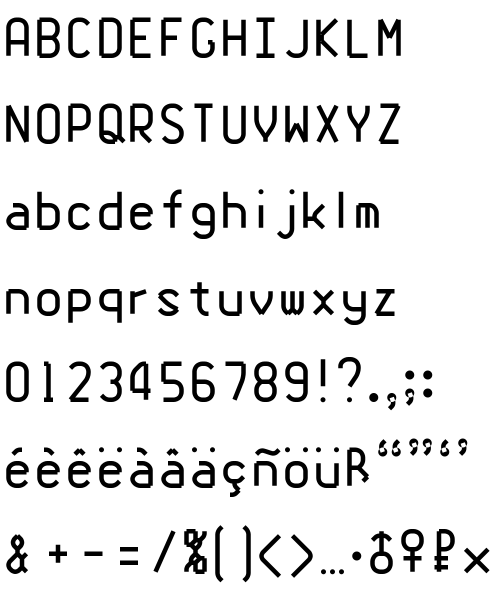
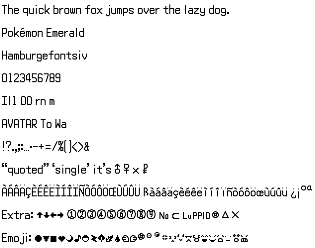

# Emerald Rounded

Pokémon Emerald's dialogue font, rebuilt as installable TrueType fonts. The pixel art of the Latin
"normal" font from the [pret/pokeemerald](https://github.com/pret/pokeemerald) decompilation is
traced two ways: once exactly, pixel for pixel, and once as a smooth reconstruction whose glyphs are
hand-tuned stroke models (polylines, arcs, dots) expanded into outlines by FontForge. The game's other
four Latin fonts (Narrow, Small, Short, Small Narrow) get the same treatment, with the hand-tuned
glyph models ported over from Normal (see [Other game fonts](#other-game-fonts)).





| Font | File | What it is |
|---|---|---|
| **Emerald Pixel Vector** | `build/fonts/EmeraldPixelVector-Regular.ttf` | Faithful, sharp pixel outlines. At 16 px it reproduces the game bitmap exactly. |
| **Emerald Rounded** | `build/fonts/EmeraldRounded-Regular.ttf` | Smooth reconstruction: stepped diagonals become clean lines, bowls become Bézier curves, spacing opened by 1 px for text. |
| **Emerald Rounded Game** | `build/fonts/EmeraldRoundedGame-Regular.ttf` | Same smooth outlines, but advances, side bearings and space width identical to the game. |
| Emerald Pixel Soft (reference) | `build/fonts/EmeraldPixelSoft-Regular.ttf` | Pixel outline with every corner softened. Kept for comparison only. |
| **Emerald Rounded Narrow Game** / **Small** / **Short** / **Small Narrow** | `build/fonts/EmeraldRounded{Narrow,Small,Short,SmallNarrow}Game-Regular.ttf` | The game's other Latin fonts as smooth outlines, game spacing and line pitch. |
| **Emerald Pixel Vector Narrow** / **Small** / **Short** / **Small Narrow** | `build/fonts/EmeraldPixelVector{Narrow,Small,Short,SmallNarrow}-Regular.ttf` | Exact pixel outlines of those fonts (the reference the smooth ones are tuned against). |
| **Emerald Rounded Narrower** / **Small Narrower** / **Short Narrow** / **Short Narrower Game**, and their Pixel Vector versions | `build/fonts/EmeraldRounded{Narrower,SmallNarrower,ShortNarrow,ShortNarrower}Game-Regular.ttf`, `build/fonts/EmeraldPixelVector{…}-Regular.ttf` | The four extra Latin fonts of [pokeemerald-expansion](https://github.com/rh-hideout/pokeemerald-expansion), same treatment. |

Each font also ships as `.otf` and as an editable FontForge `.sfd` next to the TTF. The ready-made
fonts are committed, so you can download them from `build/fonts/` without building anything.

Companion project: [font-compare](https://github.com/pizzacatz/font-compare), a local web app that
overlays the fonts, scores every glyph against the pixel original, and provides the GUI glyph editor
used to tune the smooth fonts.

## Quick install (Linux)

```sh
mkdir -p ~/.local/share/fonts
cp build/fonts/EmeraldPixelVector-Regular.ttf build/fonts/EmeraldRounded-Regular.ttf build/fonts/EmeraldRoundedGame-Regular.ttf ~/.local/share/fonts/
cp build/fonts/EmeraldRounded*Game-Regular.ttf ~/.local/share/fonts/      # optional: the Narrow, Small, Short, Small Narrow fonts
fc-cache -f
```

On Windows or macOS, double-click a TTF and choose Install.

## Source

- Sheets: `https://raw.githubusercontent.com/pret/pokeemerald/refs/heads/master/graphics/fonts/latin_normal.png`,
  and `latin_narrow.png`, `latin_small.png`, `latin_short.png`, `latin_small_narrow.png` beside it
- Mapping/width/render code: `charmap.txt`, `src/fonts.c` (`gFont{Normal,Narrow,Small,Short,SmallNarrow}LatinGlyphWidths`),
  `src/text.c` (`DecompressGlyph_*`, `CHAR_EXTRA_SYMBOL`), `include/constants/characters.h`
- Repository: https://github.com/pret/pokeemerald, revision `731ad5bfd6e6f265508d0efcca0ba42f9dcf5881`
  (master, 2026-10-01). Local copies of the files used are in `source/pokeemerald/`.
- pokeemerald-expansion's four extra fonts (`latin_narrower.png`, `latin_small_narrower.png`,
  `latin_short_narrow.png`, `latin_short_narrower.png`, `gFont{Narrower,SmallNarrower,ShortNarrow,ShortNarrower}LatinGlyphWidths`)
  are built from its files throughout, with pokeemerald's character map.
- Glyphs added by [pokeemerald-expansion](https://github.com/rh-hideout/pokeemerald-expansion) in cells
  that are blank in pokeemerald come from its sheets, width tables and charmap (revision `68a5890`,
  2026-05-14, copies in `source/pokeemerald-expansion/`): 0x38 V_D_ARROW (U+E038), 0x118 CIRCLE_HOLLOW
  (U+E118 and ○ U+25CB) in all five fonts, and 0xF7 EMOJI_DIZZYEGG (U+E0F7) in Small.
- Licensing: pokeemerald's own LICENSE file covers the decompiled *code*; the glyph artwork is
  Nintendo / Creatures / GAME FREAK property and no licence for it is asserted here. These fonts are
  a fan conversion for personal use.

## Layout of the project

```
source/pokeemerald/      downloaded source files + REVISION.txt
data/mapping.json        per sheet cell: game id, charmap Unicode, width, ink box, shadow pixels
data/codepoints.json     final code point assignment + glyph names
data/masks/              foreground/shadow masks per glyph (JSON) and sheet_fg.png
data/svg_exact/          exact pixel outlines (SVG + contour JSON)
data/svg_rounded/        treatment 2 outlines
data/svg_smooth/         treatment 3: *.json stroke model, *.centerline.svg, u*.outline.svg (final outlines)
data/glyph_overrides/    the hand-tuned glyph models (see Hand-editing glyphs)
data/<variant>/          the same layout for narrow, small, short, small_narrow, plus port_report.json
scripts/                 extract.py, smooth.py, assign_codepoints.py, build_font.py (FontForge),
                         render.py, make_comparison.py, verify.py, check_geometry.py, ff.sh,
                         port_overrides.py, raster.py, review_sheet.py (porting the models to the other fonts)
build/fonts/             TTF / OTF / SFD
build/comparisons/       treatment comparisons, source sheet, zooms
build/specimens/         text specimens at 16/24/32/64 px for each font (other fonts prefixed narrow_ etc.)
build/verification.json, build/<variant>_verification.json, build/geometry_check.json
REPORT.md                coverage, design choices, defects, verification results
```

## Setup

Only needed to rebuild or edit the fonts. Linux Mint 22 / Ubuntu 24.04 was used. Python 3.12 with Pillow is the only system requirement;
numpy, fonttools and freetype-py are installed project-locally (the project lives on an exFAT drive,
which cannot hold a venv's symlinks, so `pip --target` is used instead):

```sh
pip3 install --target pylib numpy fonttools freetype-py
```

FontForge (with Python bindings) is required to assemble the fonts. Either:

```sh
sudo apt install fontforge python3-fontforge      # preferred, distro package
```

or, with no sudo, fetch the official AppImage into `tools/` (what this build used; it embeds its own
Python 3.10, so `scripts/build_font.py` runs inside FontForge's interpreter, not the system one):

```sh
scripts/get_fontforge.sh
```

`scripts/ff.sh` picks whichever is available. Inkscape is not required; nothing in the pipeline
depends on it (it is still handy for opening the SVGs in `data/`).

## Rebuild

```sh
./build.sh                 # all nine game fonts
./build.sh small short     # just these
```

runs, per game font: extract → smooth → assign code points → FontForge builds (Normal: 4 fonts, the
others: Pixel Vector + Rounded Game) → comparison images → specimens and automated checks; then the
geometry check over every TTF. Everything is deterministic. The scripts work on one font at a time,
chosen with `EMERALD_VARIANT` (`normal` if unset), e.g. `EMERALD_VARIANT=narrow python3 scripts/smooth.py`.

## Using the fonts

Use `Emerald Pixel Vector` at multiples of 16 px (16, 32, 48 …) with hinting/antialiasing off for
pixel-perfect output. `Emerald Rounded` is intended for ordinary antialiased use at any size.
All fonts share the same scale (16 px text = the game's pixels 1:1); their line heights are the game's
line pitch: 16 px for Normal, Narrow and Narrower, 14 px for Short, Short Narrow and Short Narrower,
12 px for Small, Small Narrow and Small Narrower.

## Code points

- Everything in `charmap.txt` with a single-byte code and a glyph in the sheet maps to its Unicode
  character (A–Z, a–z, 0–9, accented Latin, punctuation, ♂ ♀ × ¥ … “ ” ‘ ’ ▶ etc.).
- Game-only glyphs sit in the Private Use Area at **U+E000 + sheet id** (so the `CHAR_EXTRA_SYMBOL`
  glyph `0xF9 0x05` "Lv" is U+E105, the emoji `0xF9 0xE7` heart is U+E1E7, `CHAR_SPACER` is U+E077).
  Where the symbol has an unambiguous Unicode form it is additionally mapped there:
  arrows ↑↓←→ (U+2190–2193 for 0x79–7C, U+2B05–2B07/2B95 for the 0x100 set), circled digits ①–⑨,
  № (U+2116), ⊂ (U+2282, the charmap's own annotation).
- See `data/codepoints.json` for the full table; `REPORT.md` lists what is missing.

## Hand-editing glyphs (parametric)

The smooth fonts are generated from a *centreline model*: every glyph is a set of strokes (polylines
and arcs through source-pixel coordinates) that FontForge expands to a 1 px wide outline. You edit
that model per glyph in `data/glyph_overrides/<name>.json`; the scripts regenerate the outlines, so
your edits survive every rebuild and stay exact.

Coordinate system (source pixels): x 0..16 left to right, y 0..16 top to bottom. Baseline y = 12,
cap top y = 3, x-height y = 6, descender bottom y = 14, accents from y = 0. Pixel centres are at .5,
so the left stem of H runs from (0.5, 3.5) to (0.5, 11.5). Advance widths come from the game table
and are not changed by overrides.

```jsonc
{
  "char": ["N", "Ñ"],          // character(s) this applies to; accents outside `rows` are still auto-traced
  "rows": [3, 12],             // band of the pixel mask that the override replaces
  "width": 1.0,                // stroke width in px for the glyph (per stroke: "width" on the stroke)
  "joint_radius": 1.0,         // default rounding radius at polyline joints, px
  "strokes": [
    {"points": [[0.5,3.5],[0.5,11.5]]},                     // straight stem
    {"points": [[4.5,3.5],[1.2,6.8,0],[1.2,8.2,0],[4.5,11.5]]}, // 3rd value = that joint's radius, 0 = sharp
    {"points": [[0.5,3.5],[2.5,3.5,0,-0.4142],[4.5,5.5,0]]},   // 4th value = bulge: segment to the next point is a circular arc (tan(angle/4), + = CCW on the page)
    {"points": [[1,9],[4,9],[4,11],[1,11]], "closed": true, "sharp": true},
    {"arc": {"center":[2.5,9], "radius":2, "start":0, "end":180}}, // degrees, CCW as on the page, 0 = right
    {"circle": {"center":[2.5,9], "radius":2}, "width": 1.1}
  ],
  "dots": [[2.5,1.5,0.5], [4.5,1.5,0.5,"square"], [6.5,1.5,0.5,"rounded",0.2]], // x, y, half-size, shape, corner radius
  "dot_shape": "circle",       // default dot shape: circle | square | rounded; "dot_corner" = default corner radius
  "join": "round",             // corner style where a stroke bends: round | miter (sharp) | bevel (flat); also per stroke
  "clip_y": [3, 12]            // keep only this band of rows (and/or "clip_x"); trims round joins flush with cap/baseline
}
```

Cut masks are subtracted one polygon at a time after the strokes are unioned, so masks may overlap each
other and may cross counters (the inside of O, B, etc.) safely; `clip_x` and `clip_y` can be combined.
A stroke entry may carry both `points` and its own `cut`.


A stroke entry `{"cut": [[x,y], ...]}` is a polygon subtracted from the finished outline, for any
trimming the join styles cannot express.

`data/glyph_overrides/_TEMPLATE.json` has every construct with notes; `N.json`, `M.json`, `K.json`,
`W.json`, `multiply.json` are working examples. Stroke ends get square caps (extended by half the
width), joints between strokes are unioned, so you can build a glyph from overlapping pieces.

Edit loop:

```sh
./preview.sh "NKa"        # regenerate model -> rebuild Emerald Rounded Game -> build/preview/
```

`build/preview/strip.png` shows the glyphs in Pixel Vector, in Rounded Game, and enlarged on the
16 px grid with both overlaid (blue = pixel original, pink = your outline, dark = agreement, the
vertical line is the advance). Per-glyph PNGs sit next to it. When happy, run `./build.sh` for all
fonts and `../font-compare/sync-fonts.sh` to refresh the web comparison, whose glyph grid,
loupe and overlay give the same comparison interactively.

The GUI for all of this is the glyph editor in [font-compare](https://github.com/pizzacatz/font-compare)
(`./serve.sh` there, then `/editor.html`): it draws on the pixel grid, edits every field above with
sliders and numbers, saves the JSON here, and rebuilds Emerald Rounded Game with one click. Its *Font*
menu switches between the five game fonts (`/editor.html?font=small&ch=a` opens one directly), and the
selected stroke can also be edited as raw JSON, every field of it, under its properties.

Free-form edits are also possible in the FontForge GUI (`tools/squashfs-root/AppRun build/fonts/X.sfd`),
but those live only in the `.sfd` and are overwritten by the next `./build.sh`.

## Other game fonts

Emerald has five Latin fonts: Normal (dialogue), Narrow, Small, Short and Small Narrow. They share the
character map and the 16×16 cell layout but are drawn separately: Narrow keeps Normal's height with most
glyphs a pixel narrower; Short keeps the width but is a row shorter (baseline y = 11); Small is narrower
with a 7 px cap height (rows 4–10, baseline y = 11); Small Narrow is Small with a few narrower glyphs. pokeemerald-expansion adds Narrower, Small Narrower, Short Narrow and Short Narrower,
narrower again, which are handled the same way. Each has its own override folder, `data/<variant>/glyph_overrides/`, with the same JSON
format and coordinate system (only the baseline row and the guides differ).

Those folders were seeded once from Normal's hand-tuned models by `scripts/port_overrides.py`, in the
convention the Normal models use: straight strokes through pixel centres, a 67.5° arc (bulge 0.3033)
wherever a stroke turns through a single diagonal pixel step, sharp joints, cut boxes trimming terminals
flush. Per glyph, the first that applies:

- **identical / transfer**: the target bitmap equals the source, or is it with whole pixel rows/columns
  deleted or doubled (Narrow "O" is Normal "O" minus its middle column). The model is remapped so every
  stroke, arc, cut and clip carries over unchanged. Most glyphs port this way.
- **fuzzy**: the closest such mapping, used when it scores better than a fresh trace.
- **traced**: a fresh model of the target pixels in the same convention.
- **hand**: modelled by hand where the result was not good enough (Narrow S X x ♂; Short W % S a e é s 2 y;
  Small & X x a e é s u ♂ , ; №), and anything saved from the glyph editor.

Small and Narrow serve as sources too (Small Narrow mostly copies Small), and each expansion font is
ported from the font it narrows. Each ported file has a
`_ported` note, and `data/<variant>/port_report.json` lists method and score per glyph (score = summed
difference between the model's ink and the pixels over the cell; the hand-tuned Normal glyphs have a
median of 2.5). The overrides are now the source of truth; the porting is not part of `./build.sh`.

```sh
python3 scripts/port_overrides.py small --force "a"   # re-port one glyph (keeps glyphs marked "hand")
python3 scripts/port_overrides.py small --replace "a" # ... even if marked "hand" (the editor's Re-port button)
python3 scripts/review_sheet.py small [--all]          # build/comparisons/small_overrides_review.png
EMERALD_VARIANT=small ./preview.sh "a"                 # rebuild Emerald Rounded Small Game, preview "a"
```

## Licence

Everything original here (scripts, override files, generated outlines, font files) is released under
[The Unlicense](LICENSE): public domain, do what you like. The underlying pixel artwork remains the
property of Nintendo / Creatures Inc. / GAME FREAK Inc.; these fonts are a fan conversion and no
licence for the artwork is granted or implied. The pokeemerald files in `source/` are reference
copies from the pret decompilation project.
